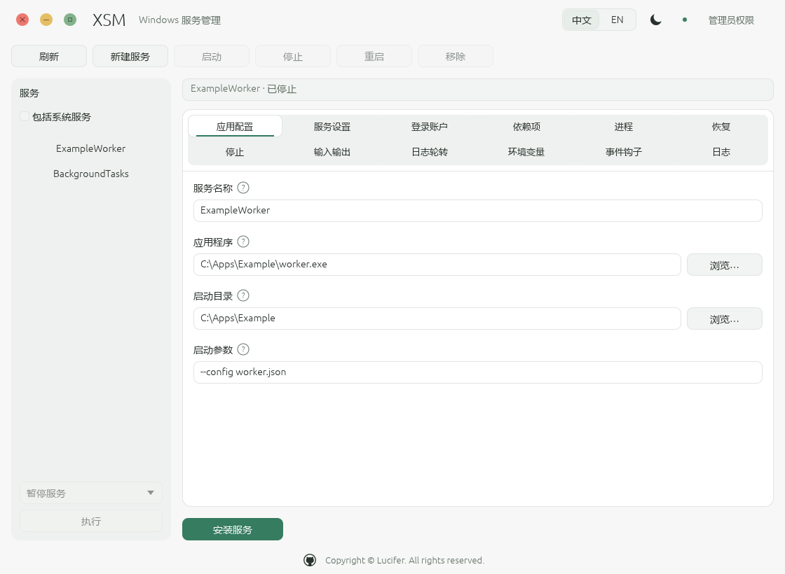
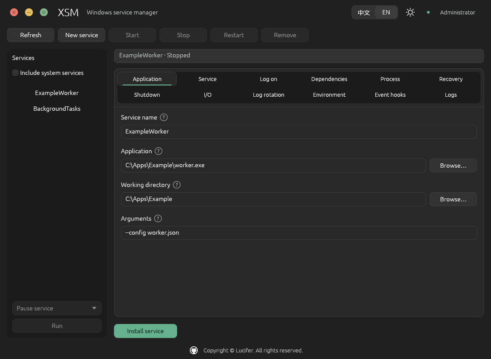

# XSM

XSM 是基于 Rust 的 Windows 服务管理器，可将普通可执行程序托管为 Windows 服务，提供命令行和可视化管理。支持 Windows 10 / Windows Server 2016 及以上。

支持应用守护、退出重启、事件钩子、环境变量、输出重定向与日志轮转；GUI 提供中英文、明暗主题和高 DPI 缩放。每个服务独立运行，关闭 GUI 不影响服务。

## GUI





## 构建

需要 Rust 1.99.1、Visual Studio C++ Build Tools 和 Windows SDK。项目已固定工具链与依赖版本。

```powershell
# 编译 Release
cargo build --release --locked --bin xsm

# 整理程序、README、截图和校验文件，生成 ZIP
.\scripts\package.ps1
```

编译产物：`target\release\xsm.exe`。交付程序：`dist\xsm.exe`；压缩包：`dist\xsm-<version>-windows-<arch>.zip`。调试构建使用 `cargo build --locked`，产物位于 `target\debug\xsm.exe`。

## 命令行

以下命令在 `xsm.exe` 所在目录执行。请将程序放在长期保留的路径，安装服务后保持该路径不变。安装、修改及控制服务需要管理员权限；GUI 可在普通权限下打开查看。

| 命令 | 用途 |
| --- | --- |
| `install [service]` | 打开可视化管理器，可预填新服务名称 |
| `install <service> <application> [arguments ...]` | 直接安装服务，安装后使用 `start` 启动 |
| `edit <service>` | 打开服务配置界面 |
| `remove [service]` | 打开可视化移除界面 |
| `remove <service> confirm` | 直接移除服务 |
| `get <service> <setting> [subparameter]` | 读取配置 |
| `set <service> <setting> [subparameter] <value ...>` | 修改配置 |
| `reset <service> <setting> [subparameter]` | 恢复默认配置，`unset` 为同义命令 |
| `start <service>` / `stop <service>` / `restart <service>` | 启动、停止或重启服务 |
| `pause <service>` / `continue <service>` | 暂停或继续支持该操作的服务 |
| `status <service>` | 输出服务状态 |
| `statuscode <service>` | 输出状态，并通过退出码返回 Windows 服务状态值 |
| `rotate <service>` | 触发日志轮转 |
| `list [all]` | 列出 XSM 服务，`all` 包含系统服务 |
| `processes <service ...>` | 查看一个或多个服务的进程 |
| `dump <service> [new-service-name]` | 导出配置恢复脚本，可指定脚本中的目标服务名 |
| `help` / `version` | 查看帮助或版本 |

### 常用示例

```powershell
# 打开 GUI
.\xsm.exe install

# 安装与配置
.\xsm.exe install MyService 'C:\Apps\worker.exe'
.\xsm.exe set MyService AppDirectory 'C:\Apps'
.\xsm.exe set MyService AppParameters '--port 9000'
.\xsm.exe set MyService Start SERVICE_DELAYED_AUTO_START
.\xsm.exe set MyService AppEnvironmentExtra 'MODE=production' 'PORT=9000'
.\xsm.exe set MyService AppExit Default Restart
.\xsm.exe set MyService AppEvents Start/Pre 'cmd.exe /c C:\Apps\before-start.cmd'

# 日志
.\xsm.exe set MyService XsmLogLevel info
.\xsm.exe set MyService XsmLogPath 'C:\Logs\MyService\internal.log'
.\xsm.exe set MyService AppStdout 'C:\Logs\MyService\stdout.log'
.\xsm.exe set MyService AppStderr 'C:\Logs\MyService\stderr.log'
.\xsm.exe set MyService AppRotateFiles 1
.\xsm.exe set MyService AppRotateOnline 1
.\xsm.exe set MyService AppRotateBytes 10485760

# 管理服务
.\xsm.exe start MyService
.\xsm.exe status MyService
.\xsm.exe get MyService Application
.\xsm.exe processes MyService
.\xsm.exe restart MyService
.\xsm.exe stop MyService
.\xsm.exe remove MyService confirm
```

`XsmLogLevel` 支持 `off`、`error`、`warn`、`info`、`debug`、`trace`。`AppEvents` 支持 `Start/Pre`、`Start/Post`、`Stop/Pre`、`Exit/Post`、`Power/Change`、`Power/Resume`、`Rotate/Pre`、`Rotate/Post`。

`statuscode` 的状态退出码：1 已停止、2 启动中、3 停止中、4 运行中、5 继续中、6 暂停中、7 已暂停；服务查询失败返回 0。修改运行策略后使用 `restart` 使新配置生效。应用参数中需要保留的引号，应作为 `AppParameters` 值的一部分传入。

配置导出供 `cmd.exe` 回放：

```batch
xsm.exe dump MyService MyServiceCopy > restore.cmd
cmd.exe /c restore.cmd
```
